<p align="center">
  <a href="https://maritime.sh">
    <picture>
      <source media="(prefers-color-scheme: dark)" srcset="assets/hero-dark.png">
      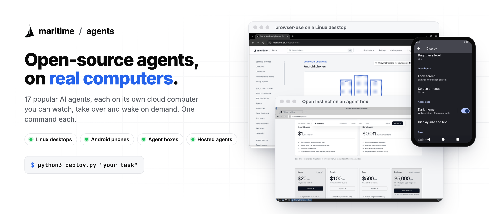
    </picture>
  </a>
</p>

<!-- BADGES:START -->
<p align="center"><a href="#the-agents"></a> <a href="LICENSE"></a> <a href="https://github.com/maritime-sh/agents/actions/workflows/check.yml"></a> <a href="https://maritime.sh/docs"></a> <a href="https://discord.gg/wvPAvXNZqm"></a> <a href="https://x.com/maritime_sh"></a></p>
<!-- BADGES:END -->

<p align="center">
  <b>Popular open-source AI agents, each running on its own <a href="https://maritime.sh">Maritime</a> computer.</b><br>
  A Linux desktop, an Android phone, an agent box or a hosted agent in the cloud, set up with one command.<br>
  Watch the agent live, take over the screen when it needs you, and let it sleep until the next task.
</p>

<p align="center">
  <a href="#quickstart">Quickstart</a> ·
  <a href="#the-agents">The agents</a> ·
  <a href="#how-it-works">How it works</a> ·
  <a href="https://maritime.sh/docs">Docs</a> ·
  <a href="CONTRIBUTING.md">Add an agent</a>
</p>

## Watch them work

Every clip below is a real run on a Maritime computer, recorded from its screen.

<!-- GALLERY:START -->
<table>
<tr><td align="center" valign="top" width="33%"><a href="browser-use/">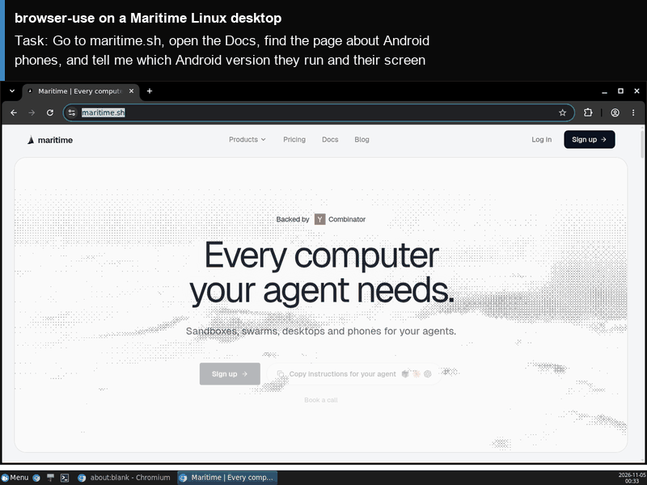</a><br><b>browser-use</b><br><sub>Linux desktop</sub></td><td align="center" valign="top" width="33%"><a href="browser-use-web-ui/">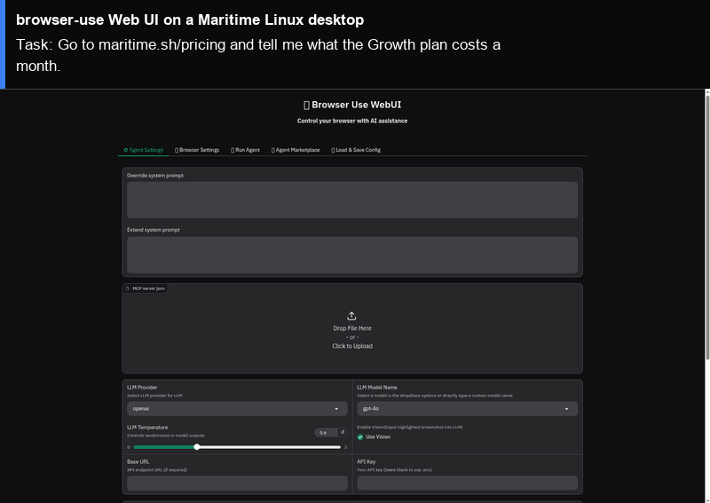</a><br><b>browser-use Web UI</b><br><sub>Linux desktop</sub></td><td align="center" valign="top" width="33%"><a href="openmanus/">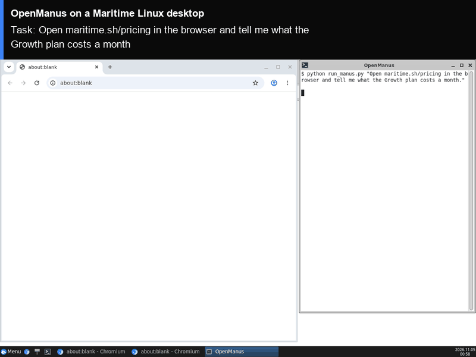</a><br><b>OpenManus</b><br><sub>Linux desktop</sub></td></tr>
<tr><td align="center" valign="top" width="33%"><a href="open-interpreter/">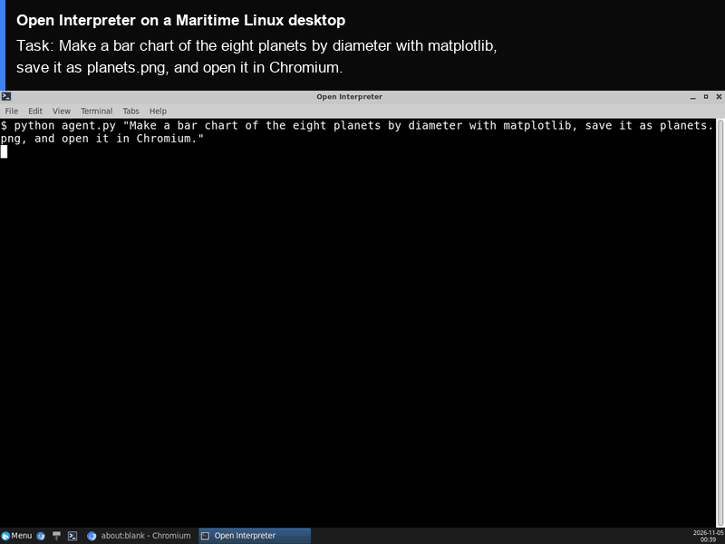</a><br><b>Open Interpreter</b><br><sub>Linux desktop</sub></td><td align="center" valign="top" width="33%"><a href="aider/">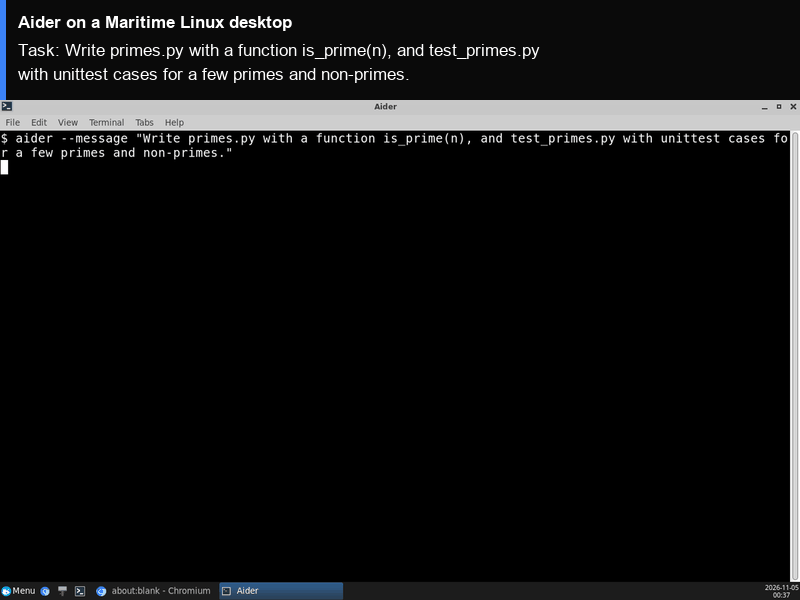</a><br><b>Aider</b><br><sub>Linux desktop</sub></td><td align="center" valign="top" width="33%"><a href="smolagents/">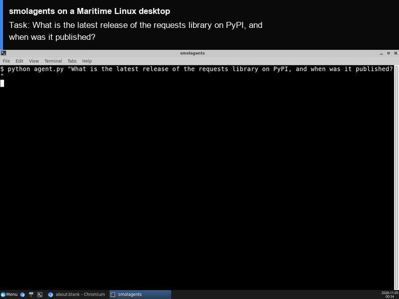</a><br><b>smolagents</b><br><sub>Linux desktop</sub></td></tr>
<tr><td align="center" valign="top" width="33%"><a href="crewai/">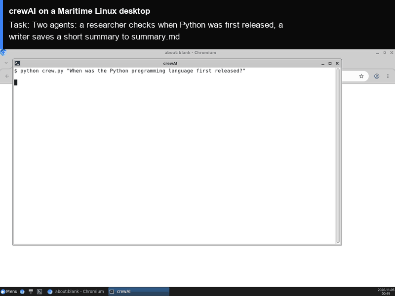</a><br><b>crewAI</b><br><sub>Linux desktop</sub></td><td align="center" valign="top" width="33%"><a href="goose/">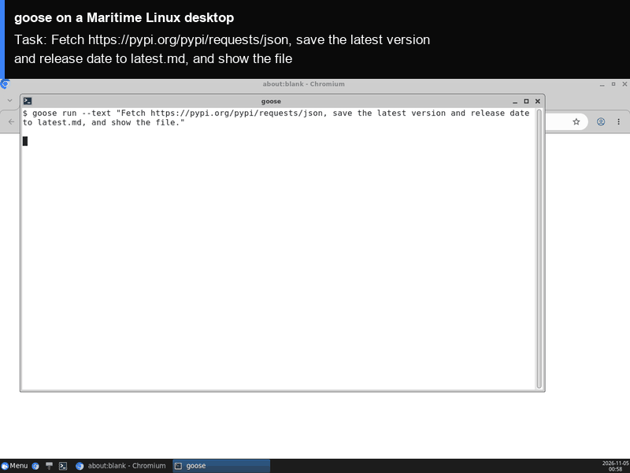</a><br><b>goose</b><br><sub>Linux desktop</sub></td><td align="center" valign="top" width="33%"><a href="gpt-researcher/">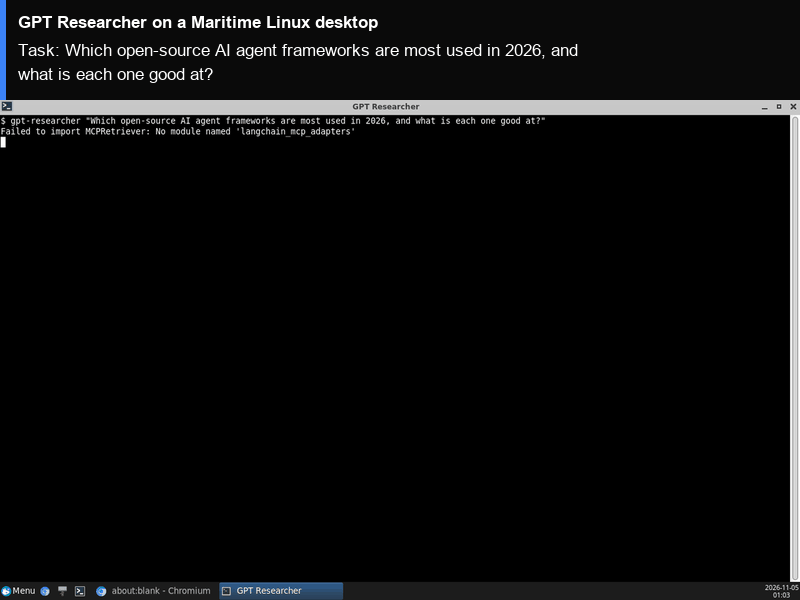</a><br><b>GPT Researcher</b><br><sub>Linux desktop</sub></td></tr>
<tr><td align="center" valign="top" width="33%"><a href="mobilerun/">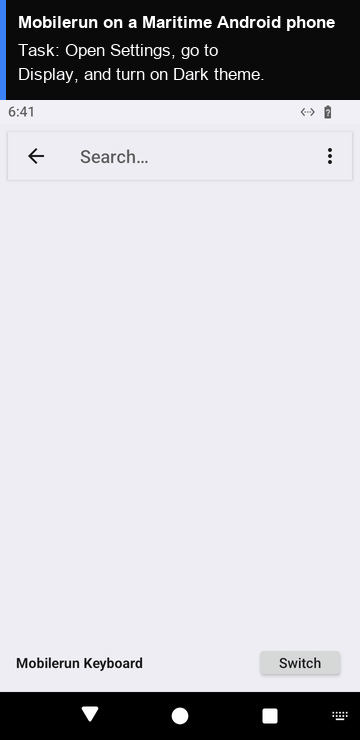</a><br><b>Mobilerun</b><br><sub>Android phone</sub></td><td align="center" valign="top" width="33%"><a href="mobile-use/">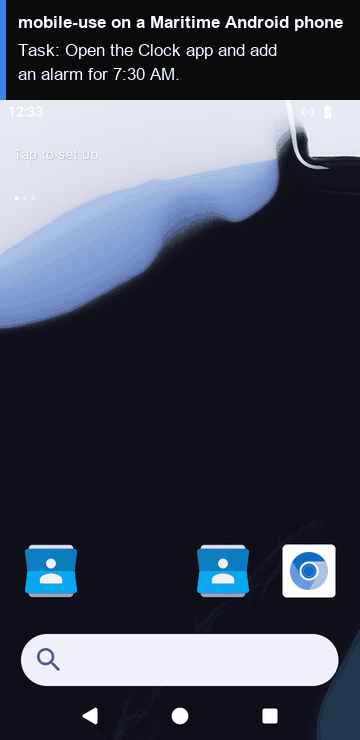</a><br><b>mobile-use</b><br><sub>Android phone</sub></td><td align="center" valign="top" width="33%"><a href="open-instinct/">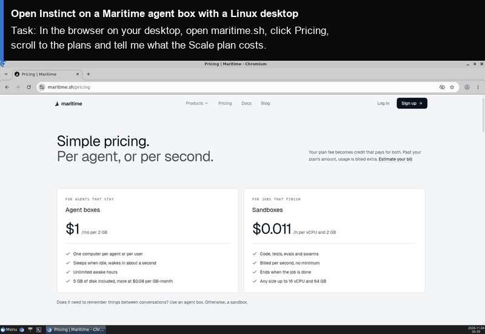</a><br><b>Open Instinct</b><br><sub>Agent box with a desktop</sub></td></tr>
<tr><td align="center" valign="top" width="33%"><a href="openclaw/">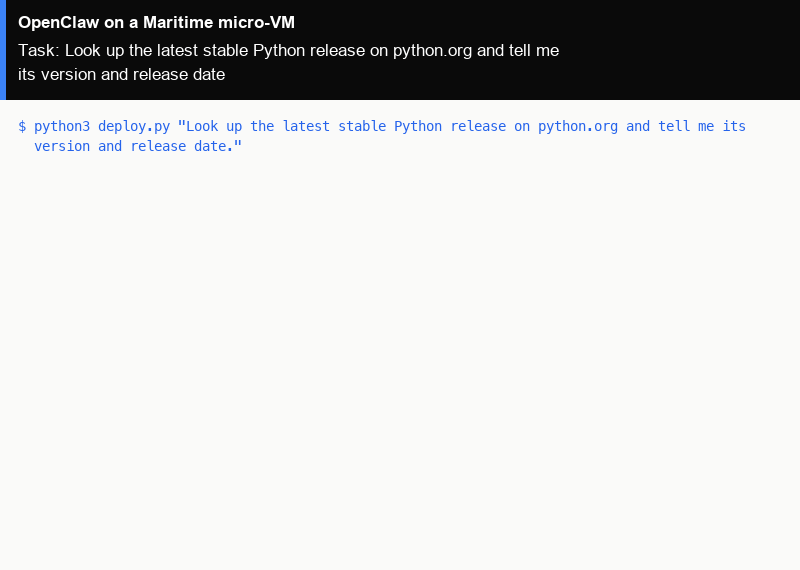</a><br><b>OpenClaw</b><br><sub>Hosted agent</sub></td><td align="center" valign="top" width="33%"><a href="hermes-agent/">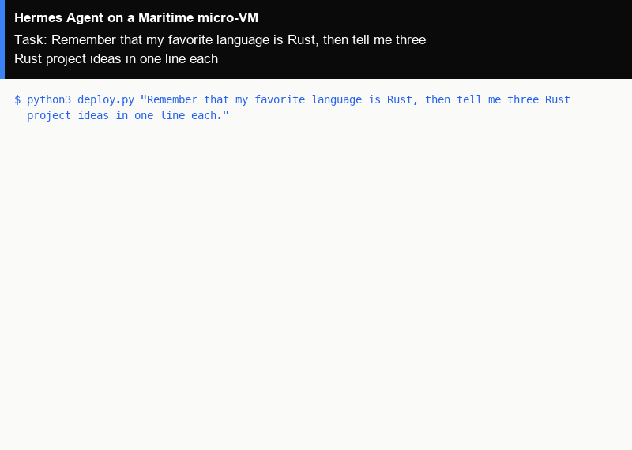</a><br><b>Hermes Agent</b><br><sub>Hosted agent</sub></td><td align="center" valign="top" width="33%"><a href="codex/">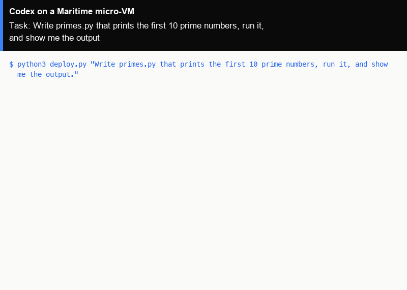</a><br><b>Codex</b><br><sub>Hosted agent</sub></td></tr>
<tr><td align="center" valign="top" width="33%"><a href="deepseek-harness/">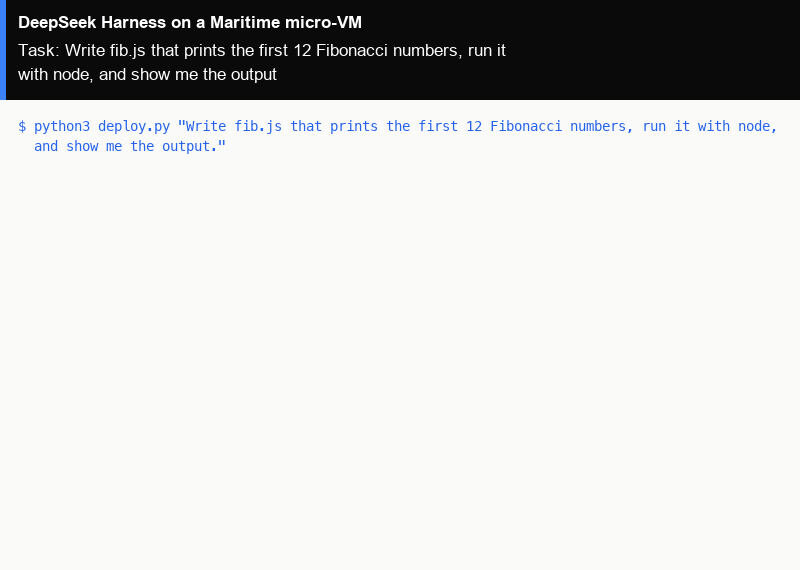</a><br><b>DeepSeek Harness</b><br><sub>Hosted agent</sub></td><td align="center" valign="top" width="33%"><a href="zeroclaw/">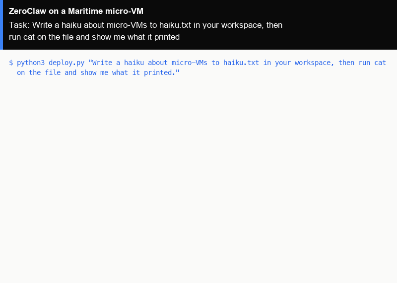</a><br><b>ZeroClaw</b><br><sub>Hosted agent</sub></td></tr>
</table>
<!-- GALLERY:END -->

## Quickstart

```bash
git clone https://github.com/maritime-sh/agents && cd agents/browser-use
export MARITIME_API_KEY=mk_...        # maritime.sh/settings/api-keys
export OPENAI_API_KEY=sk-...          # or ANTHROPIC_API_KEY, or GOOGLE_API_KEY
python3 deploy.py "Go to maritime.sh/pricing and tell me what the Growth plan costs a month"
```

That one command:

1. starts a Linux desktop on Maritime, or reuses the one you already have,
2. installs the agent's official release, pinned to an exact version,
3. prints a link to watch the screen live,
4. runs your task and streams the agent's steps and its answer.

Run it again with a new task: the same computer wakes up with everything still installed. No Docker, no VMs on your laptop: `deploy.py` needs only Python 3.

## The agents

<!-- CATALOG:START -->
### Linux desktop

Agents that use a screen and a browser on a persistent Linux desktop.

| Agent | What it does | Upstream | License | Folder |
|---|---|---|---|---|
| **browser-use** | Give it a task in plain English and it drives a real browser to finish it. | [browser-use/browser-use](https://github.com/browser-use/browser-use) `0.13.14` | MIT | [`browser-use/`](browser-use/) |
| **browser-use Web UI** | A web app for browser-use: type a task, watch the agent's browser work. | [browser-use/web-ui](https://github.com/browser-use/web-ui) `v3.0.0` | MIT | [`browser-use-web-ui/`](browser-use-web-ui/) |
| **OpenManus** | A general agent that plans, browses and uses tools to finish a task. | [FoundationAgents/OpenManus](https://github.com/FoundationAgents/OpenManus) `3309bf4` | MIT | [`openmanus/`](openmanus/) |
| **Open Interpreter** | Ask in plain English; it writes and runs code on the computer until the task is done. | [openinterpreter/openinterpreter](https://github.com/openinterpreter/openinterpreter) `0.4.3` | AGPL-3.0 | [`open-interpreter/`](open-interpreter/) |
| **Aider** | AI pair programming in a git repo: edits files, runs tests, commits. | [Aider-AI/aider](https://github.com/Aider-AI/aider) `0.86.2` | Apache-2.0 | [`aider/`](aider/) |
| **smolagents** | Hugging Face's agents that think in code, with web search and tools. | [huggingface/smolagents](https://github.com/huggingface/smolagents) `1.26.0` | Apache-2.0 | [`smolagents/`](smolagents/) |
| **crewAI** | A crew of role-playing agents that research and write together. | [crewAIInc/crewAI](https://github.com/crewAIInc/crewAI) `1.15.34` | MIT | [`crewai/`](crewai/) |
| **goose** | A terminal agent that writes and runs shell commands and code for you. | [aaif-goose/goose](https://github.com/aaif-goose/goose) `v1.57.0` | Apache-2.0 | [`goose/`](goose/) |
| **GPT Researcher** | Researches a question across many sources and writes a cited report. | [assafelovic/gpt-researcher](https://github.com/assafelovic/gpt-researcher) `0.16.1` | Apache-2.0 | [`gpt-researcher/`](gpt-researcher/) |

### Android phone

Agents that use apps on an Android 15 phone in the cloud.

| Agent | What it does | Upstream | License | Folder |
|---|---|---|---|---|
| **Mobilerun** | Uses Android apps for you: reads the screen, taps, swipes and types. Formerly DroidRun. | [droidrun/mobilerun](https://github.com/droidrun/mobilerun) `0.7.4` | MIT | [`mobilerun/`](mobilerun/) |
| **mobile-use** | An agent that operates Android apps from a goal in plain English. | [minitap-ai/mobile-use](https://github.com/minitap-ai/mobile-use) `4.0.0` | Apache-2.0 | [`mobile-use/`](mobile-use/) |

### Agent box

Agents that live in their own micro-VM with a disk that persists, awake when there is work.

| Agent | What it does | Upstream | License | Folder |
|---|---|---|---|---|
| **Open Instinct** | A personal agent you text, with its own computer, that works with the agents of people you trust. | [mariagorskikh/open-instinct](https://github.com/mariagorskikh/open-instinct) `2e5e71b` | MIT | [`open-instinct/`](open-instinct/) |

### Hosted agent template

Agents Maritime hosts from a template, with chat, triggers and channels.

| Agent | What it does | Upstream | License | Folder |
|---|---|---|---|---|
| **OpenClaw** | An autonomous personal agent with a large library of skills. | [openclaw/openclaw](https://github.com/openclaw/openclaw) `2026.7.1` | MIT | [`openclaw/`](openclaw/) |
| **Hermes Agent** | Nous Research's agent that remembers you and improves its own skills. | [NousResearch/hermes-agent](https://github.com/NousResearch/hermes-agent) `v2026.5.16` | MIT | [`hermes-agent/`](hermes-agent/) |
| **Codex** | OpenAI's coding agent: writes, runs and fixes code in its own workspace. | [openai/codex](https://github.com/openai/codex) `0.154.0` | Apache-2.0 | [`codex/`](codex/) |
| **DeepSeek Harness** | DeepSeek's plugin-based agent harness with a full web workbench. | [deepseek-ai/deepseek-harness](https://github.com/deepseek-ai/deepseek-harness) `0.1.0-rc.7` | MIT | [`deepseek-harness/`](deepseek-harness/) |
| **ZeroClaw** | A lightweight agent written in Rust, small enough to run almost anywhere. | [zeroclaw-labs/zeroclaw](https://github.com/zeroclaw-labs/zeroclaw) `v0.8.5` | MIT or Apache-2.0 | [`zeroclaw/`](zeroclaw/) |
<!-- CATALOG:END -->

Coming next: Claude Computer Use, UI-TARS Desktop on Windows, and more in [BACKLOG.md](BACKLOG.md). Want one sooner? [Open an issue](https://github.com/maritime-sh/agents/issues/new?template=new-agent.yml).

## How it works

<p align="center">
  <picture>
    <source media="(prefers-color-scheme: dark)" srcset="assets/how-dark.png">
    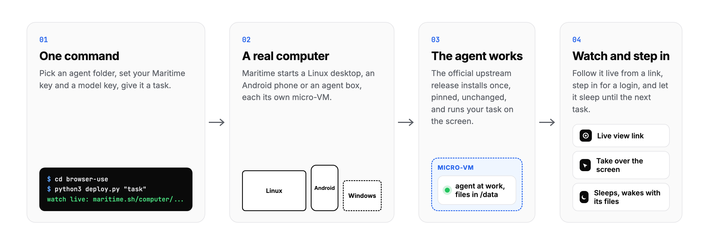
  </picture>
</p>

Each folder is a thin wrapper. It installs the upstream project exactly as its authors publish it, so updates are a version bump, and nothing here is a fork.

```
<agent>/
  README.md     what it does, how to run it, upstream version and license
  deploy.py     one command: get a computer, install, run your task
  agent/        what gets installed and run inside the computer
  demo.gif      a real run, about 30 seconds
common/         a tiny Maritime REST client, the adb tunnel, the GIF recorder
agents.json     the catalog, for people and for agents
```

## Why give an agent its own computer

- **Real software.** Agents that click and type need a screen, a browser and real apps, not just a shell.
- **It remembers.** Logins, downloads and installed apps survive sleep and restarts. The second run starts where the first one ended.
- **A person can step in.** Watch any run from a link. Take over the screen for a login code or a signature, then hand it back.
- **Isolated.** Every computer is its own Firecracker micro-VM with its own kernel.
- **Pay for the work.** Billed per second while awake. Asleep, you pay only for its disk.

| Computer | What you get | Price while awake |
|---|---|---|
| Linux desktop | Debian with a desktop and Chromium, 1280x800 | $0.12 an hour |
| Android phone | Android 15, 720x1280, apps as APKs, adb tunnel | $0.15 an hour |
| Windows desktop | Windows with the desktop experience, licence included | $0.18 an hour |
| Agent box | A micro-VM with a disk that persists | $1 a month per 2 GB |

Full details: [maritime.sh/pricing](https://maritime.sh/pricing). New accounts start with a 7-day free trial.

## FAQ

<details>
<summary><b>Do I need my own model key?</b></summary>
<br>
Most agents here work with any OpenAI-compatible endpoint, including <a href="https://maritime.sh/docs/llm">Maritime LLM</a>, so your Maritime account can be the only key you need. Each folder lists the keys it accepts.
</details>

<details>
<summary><b>Is this a fork of these projects?</b></summary>
<br>
No. Every folder installs the official upstream release at a pinned version and changes none of its code. If an agent ever needs a change its authors would not take, its folder will say so.
</details>

<details>
<summary><b>Can I use my own computers instead?</b></summary>
<br>
Yes, the upstream projects run anywhere. This repository is for when you want each agent on a clean, isolated computer you can watch, share by link, and leave asleep for days.
</details>

<details>
<summary><b>How is each agent tested?</b></summary>
<br>
By running its own one command on a real Maritime computer, the way you would. Every run is logged in <a href="TESTING.md">TESTING.md</a>, and the demo GIFs come from those runs.
</details>

## Contributing

New agents and fixes are welcome: see [CONTRIBUTING.md](CONTRIBUTING.md). Security reports go to [SECURITY.md](SECURITY.md).

## License

MIT for everything in this repository. Each upstream project keeps its own license, listed in its folder. Every folder is a community integration: Maritime is not affiliated with, and not endorsed by, the projects listed here, and their names belong to their owners.

<p align="center">
  <a href="https://maritime.sh">
    <picture>
      <source media="(prefers-color-scheme: dark)" srcset="assets/maritime-mark-white.png">
      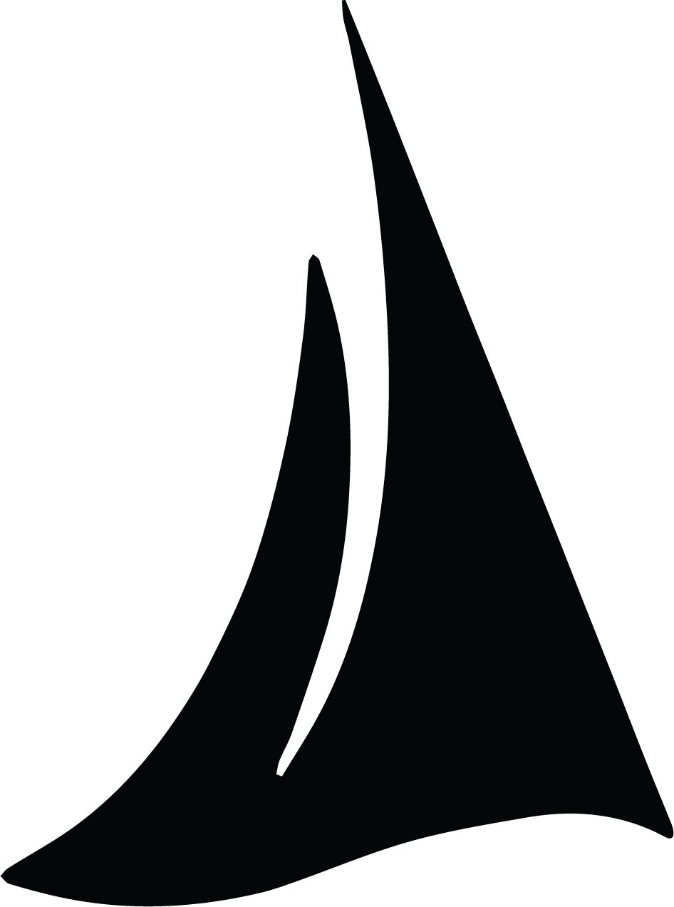
    </picture>
  </a><br>
  <sub>Built by <a href="https://maritime.sh">Maritime</a>: computers for AI agents.</sub>
</p>
