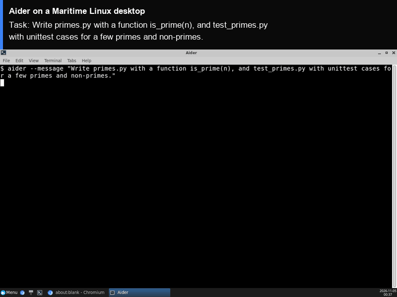

# Aider on a Maritime Linux desktop

[Aider](https://github.com/Aider-AI/aider) is an AI pair programmer for the terminal: you describe a change, it edits the files in a git repo, commits the result and can run your tests. Here it runs on its own Maritime Linux desktop, in a terminal window you can watch live, with every task in a fresh git repo under `/data` that stays on the computer between runs.

<p align="center"></p>

[](https://maritime.sh/dashboard/new-sandbox?type=computers&agent=aider)

## Run it

```bash
git clone https://github.com/maritime-sh/agents && cd agents/aider
export MARITIME_API_KEY=mk_...                     # maritime.sh, Settings, API keys
export OPENAI_API_KEY=sk-...                       # any OpenAI-compatible endpoint
export OPENAI_BASE_URL=https://api.openai.com/v1   # optional, for another endpoint
python3 deploy.py "Write primes.py with a function is_prime(n), and test_primes.py with unittest cases for a few primes and non-primes."
```

The script prints a link to watch the desktop, installs Aider the first time (about a minute), opens a terminal on the desktop, runs the task, runs the tests, and streams the session to your terminal. Run it again with a new task and it reuses the same computer, already set up.

| | |
|---|---|
| Computer | Linux desktop (Debian, XFCE), $0.12 an hour while awake |
| Upstream | `aider-chat==0.86.2` from PyPI, unchanged |
| Model | Any OpenAI-compatible endpoint (`OPENAI_API_KEY`, optional `OPENAI_BASE_URL`). `AIDER_MODEL` picks the model, default `gpt-5.4` |
| Where it runs | Inside the computer, under `/data/agents/aider`. Each task's repo is `/data/projects/aider-<time>` |
| Needs | Python 3.9+ on your machine (standard library only) |

## How it works

- `deploy.py` creates (or reuses) the computer through the Maritime REST API and uploads `agent/`.
- `agent/install.sh` installs `uv`, Python 3.12 and the pinned Aider release into `/data`, which survives sleep and restarts.
- `agent/run.sh` opens a terminal window on the desktop and runs `agent/session.sh` in it: a new git repo, `aider --message "<task>" --yes-always --auto-test`, then `python3 -m unittest` and `git log` so you see the result.
- Your model key is written to `/data/agents/aider/.env` with mode 600, on your own computer only.

## Tested

End to end on a real Maritime Linux desktop, from a clean computer: see [TESTING.md](../TESTING.md).

## License and credits

Aider is licensed under the Apache License 2.0; its `LICENSE.txt` carries no copyright line (the project is by Paul Gauthier and contributors). This folder is MIT licensed.

This is a community integration, not affiliated with or endorsed by Aider.
