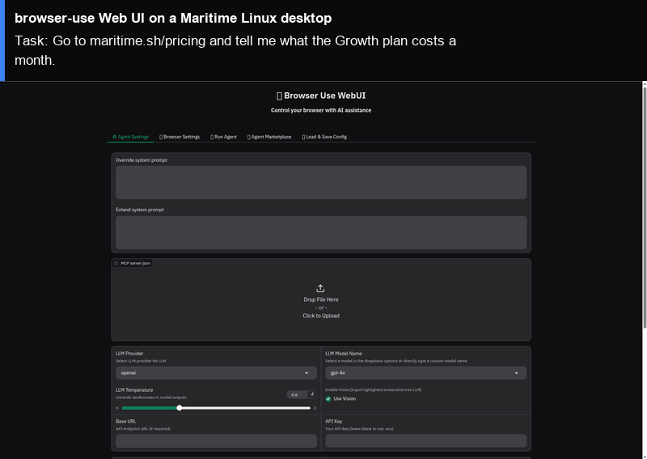

# browser-use Web UI on a Maritime Linux desktop

[browser-use Web UI](https://github.com/browser-use/web-ui) is a Gradio app for [browser-use](https://github.com/browser-use/browser-use): you pick a model, type a task, and watch the agent drive a browser while the UI shows each step and its reasoning. Here both run on one Maritime Linux desktop: the Web UI open in the desktop's Chromium, and the agent's browser in a second Chromium window next to it. Open the watch link to see both, or take over the screen to use the UI yourself.

<p align="center"></p>

[](https://maritime.sh/dashboard/new-sandbox?type=computers&agent=browser-use-web-ui)

## Run it

```bash
git clone https://github.com/maritime-sh/agents && cd agents/browser-use-web-ui
export MARITIME_API_KEY=mk_...            # maritime.sh, Settings, API keys
export OPENAI_API_KEY=...                 # plus OPENAI_BASE_URL; or ANTHROPIC_API_KEY, GOOGLE_API_KEY, DEEPSEEK_API_KEY
python3 deploy.py                         # install, start, and open the Web UI on the desktop
python3 deploy.py "Go to maritime.sh/pricing and tell me what the Growth plan costs a month."
```

Without a task, the script installs the Web UI the first time (under a minute), starts it, opens it on the desktop, and prints the watch link. With a task, it also types the task into Run Agent, submits it, waits for the agent, and prints its final answer.

| | |
|---|---|
| Computer | Linux desktop (Debian, XFCE, Chromium), $0.12 an hour while awake |
| Upstream | Release `v3.0.0` from GitHub (the tag's source, unchanged), on Python 3.11 with its `requirements.txt` (`browser-use==0.1.48`). Other dependencies are held to the versions it was tested with (`agent/constraints.txt`) |
| Model | The Web UI's own menu. The first key you set picks the provider; with `OPENAI_BASE_URL` set, OpenAI requests go to that endpoint. Tested with its default model, `gpt-4o`, through an OpenAI-compatible endpoint |
| Where it runs | Inside the computer, under `/data/agents/browser-use-web-ui`, on `http://127.0.0.1:7788` (not exposed). The agent's browser profile is `/data/agents/browser-use-web-ui/profile` |
| Needs | Python 3.9+ on your machine (standard library only) |

## How it works

- `deploy.py` creates (or reuses) the computer through the Maritime REST API and uploads `agent/`.
- `agent/install.sh` downloads the `v3.0.0` source, installs `uv`, Python 3.11 and the requirements into `/data`, which survives sleep and restarts.
- `deploy.py` writes the Web UI's `.env` (mode 600) with your key and these settings: the desktop's own Chromium (`USE_OWN_BROWSER=true`, `BROWSER_PATH=/usr/bin/chromium`), a persistent profile, and telemetry off (`ANONYMIZED_TELEMETRY=false`, `GRADIO_ANALYTICS_ENABLED=False`).
- `agent/start.sh` starts the Web UI and opens it in Chromium. The agent's browser is reached at `localhost`, which the current desktop image does not list in `/etc/hosts`, so the Web UI gets its own `/etc/hosts` in a private mount namespace (still as the desktop user, no root).
- With a task, `deploy.py` clicks Run Agent, types the task with `xdotool`, submits it, and reads the answer from the run's history file (`tmp/agent_history`).

## Tested

End to end on a real Maritime Linux desktop, from a clean computer: see [TESTING.md](../TESTING.md).

## License and credits

browser-use Web UI is MIT licensed (Copyright (c) 2024 Browser Use Inc.). This folder is MIT licensed.

This is a community integration, not affiliated with or endorsed by browser-use.
