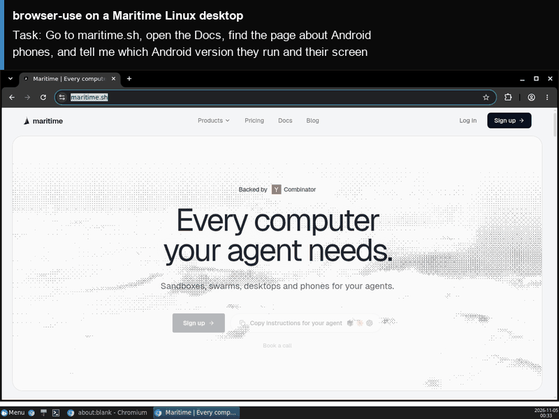

# browser-use on a Maritime Linux desktop

[browser-use](https://github.com/browser-use/browser-use) is the most popular open-source agent for the web: you give it a task in plain English and it drives a real browser to finish it. Here it runs on its own Maritime Linux desktop, with the browser on a screen you can watch live and take over at any moment. Its logins stay on the computer between runs.

<p align="center"></p>

[](https://maritime.sh/dashboard/new-sandbox?type=computers&agent=browser-use)

## Run it

```bash
git clone https://github.com/maritime-sh/agents && cd agents/browser-use
export MARITIME_API_KEY=mk_...            # maritime.sh, Settings, API keys
export ANTHROPIC_API_KEY=sk-ant-...       # or OPENAI_API_KEY, or GOOGLE_API_KEY
python3 deploy.py "Go to maritime.sh/pricing and tell me what the Growth plan costs a month"
```

The script prints a link to watch the desktop, installs browser-use the first time (about two minutes), runs the task, and streams the agent's steps and final answer. Run it again with a new task and it reuses the same computer, already set up.

| | |
|---|---|
| Computer | Linux desktop (Debian, XFCE, Chromium), $0.12 an hour while awake |
| Upstream | `browser-use==0.13.14` from PyPI, unchanged |
| Model | Claude, any OpenAI-compatible endpoint (`OPENAI_BASE_URL`), or Gemini. `BROWSER_USE_MODEL` picks the model |
| Where it runs | Inside the computer, under `/data/agents/browser-use`. The browser profile is `/data/agents/browser-use/profile` |
| Needs | Python 3.9+ on your machine (standard library only) |

## How it works

- `deploy.py` creates (or reuses) the computer through the Maritime REST API and uploads `agent/`.
- `agent/install.sh` installs `uv` and the pinned browser-use release into `/data`, which survives sleep and restarts.
- `agent/run.py` starts browser-use with the desktop's Chromium, headful on the computer's screen, and your model.
- Your model key is written to `/data/agents/browser-use/.env` with mode 600, on your own computer only.

## Tested

End to end on a real Maritime Linux desktop: see [TESTING.md](../TESTING.md).

## License and credits

browser-use is MIT licensed (Copyright (c) 2024 Gregor Zunic). This folder is MIT licensed.

This is a community integration, not affiliated with or endorsed by browser-use.
