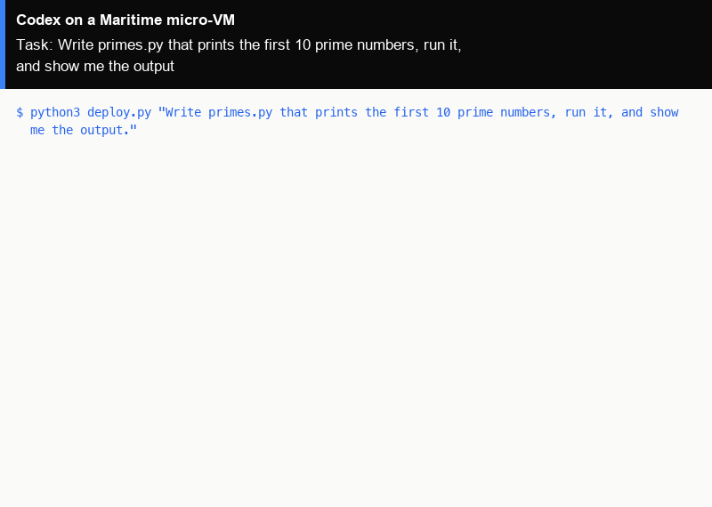

# Codex as a hosted agent on Maritime

[Codex](https://github.com/openai/codex) is OpenAI's open-source coding agent for the command line: it reads and edits files, runs commands and works through a task on its own. Here the Codex CLI runs as a Maritime hosted agent: its own micro-VM with a persistent workspace, which sleeps when idle and wakes on the next message, so files it wrote are still there on the next task. One command creates it and gives it a coding task.

<p align="center"></p>

[](https://maritime.sh/agents/new?template=codex)

## Run it

```bash
git clone https://github.com/maritime-sh/agents && cd agents/codex
export MARITIME_API_KEY=mk_...            # maritime.sh, Settings, API keys
python3 deploy.py "Write primes.py that prints the first 10 prime numbers, run it, and show me the output."
```

The first run creates the agent `lib-codex` from Maritime's `codex` template, waits until it is active (about two minutes), sends your task through chat and prints the reply. Run it again with a new task and it talks to the same agent, waking it if it is asleep. `--name` picks another agent name.

No model key is needed: the agent uses Maritime LLM, paid from your account's AI credits. To pay your provider directly instead, add `OPENAI_API_KEY` as a secret environment variable in the agent's Settings on maritime.sh and restart it. You can also sign in with a ChatGPT plan from the agent's Terminal tab (`codex login --device-auth`).

| | |
|---|---|
| Computer | A hosted agent: its own Firecracker micro-VM that sleeps when idle and wakes on the next message |
| Upstream | The Codex CLI `@openai/codex@0.154.0` from npm, unchanged, inside Maritime's `codex` template image `ghcr.io/maritime-sh/codex-agent@sha256:93aaaa891f8f04f4e68b39adc42a8c322da3292ffefadb3b622c794ce1c8288f` |
| Model | Maritime LLM by default (Codex talks to it over the Responses API), your own OpenAI key set on the agent, or a ChatGPT sign-in. `CODEX_MODEL` picks the model |
| Where it runs | Inside the agent's micro-VM. The workspace is `/data/workspace`; Codex's sessions and config are in `/data/.codex`, and both survive sleep and restarts |
| Needs | Python 3.9+ on your machine (standard library only) |

## How it works

- `deploy.py` (Python 3, standard library only) calls the Maritime REST API: `POST /api/agents` with `templateId: "codex"`, then `GET /api/agents/{id}` until the status is `active`.
- Your task goes to `POST /api/agents/{id}/chat`. A turn that runs longer than the request comes back as a receipt, and the script polls it until the reply is ready.
- The template image adds a small Node server that speaks Maritime's two-endpoint agent contract (`GET /health`, `POST /chat`). Each chat message becomes one `codex exec` run in `/data/workspace`; the Codex CLI itself is the npm release, unchanged.
- Codex runs with approvals and its own sandbox off, because the micro-VM is the sandbox: it can only change its own machine.
- Follow-up tasks build on earlier ones: the next `deploy.py` run finds the files the last one wrote. The agent's Terminal tab on maritime.sh runs the interactive `codex` TUI in the same workspace. More in the [Codex guide](https://maritime.sh/docs/frameworks/codex).
- `../common/terminal_frames.py` turned the real output of a run into the demo GIF, with `common/make_gif.py`.

## Tested

End to end on a real Maritime account, from a fresh agent: see [TESTING.md](../TESTING.md).

## License and credits

Codex is Apache 2.0 licensed (Copyright 2025 OpenAI). This folder is MIT licensed.

This is a community integration, not affiliated with or endorsed by OpenAI.
