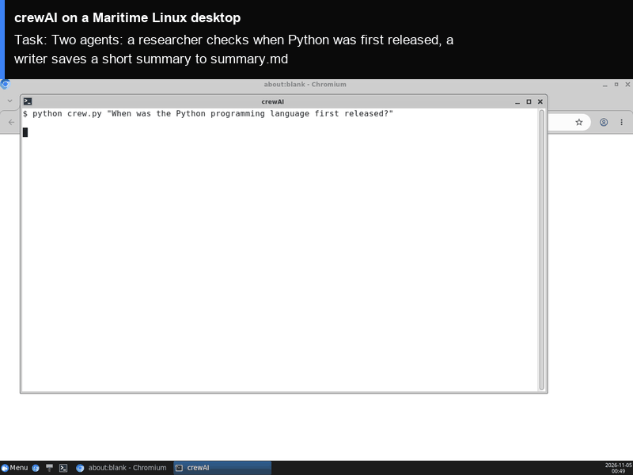

# crewAI on a Maritime Linux desktop

[crewAI](https://github.com/crewAIInc/crewAI) is a Python framework for teams of AI agents that each have a role and work through tasks together. This folder runs a small crew of two on its own Maritime Linux desktop: a researcher answers your question from live web pages, and a writer turns the research into a short summary file. The run plays in a terminal on the computer's screen that you can watch live, and the summary stays on the computer.

<p align="center"></p>

[](https://maritime.sh/dashboard/new-sandbox?type=computers&agent=crewai)

## Run it

```bash
git clone https://github.com/maritime-sh/agents && cd agents/crewai
export MARITIME_API_KEY=mk_...            # maritime.sh, Settings, API keys
export OPENAI_API_KEY=sk-...              # any OpenAI-compatible endpoint
export OPENAI_BASE_URL=https://...        # optional, for an endpoint other than OpenAI
python3 deploy.py "When was the Python programming language first released?"
```

The script prints a link to watch the desktop, installs crewAI the first time (about two minutes), opens a terminal on the desktop, runs the crew, and streams its steps and final answer. The summary is saved to `/data/agents/crewai/work/summary.md`. Run it again with a new question and it reuses the same computer.

| | |
|---|---|
| Computer | Linux desktop (Debian, XFCE, Chromium), $0.12 an hour while awake |
| Upstream | `crewai==1.15.34` and `crewai-tools==1.15.34` from PyPI, unchanged |
| Model | Any OpenAI-compatible endpoint (`OPENAI_BASE_URL`). `CREWAI_MODEL` picks the model (default `gpt-5.4`) |
| Where it runs | Inside the computer, under `/data/agents/crewai` |
| Needs | Python 3.9+ on your machine (standard library only) |

## How it works

- `deploy.py` creates (or reuses) the computer through the Maritime REST API and uploads `agent/`.
- `agent/install.sh` installs `uv` and the pinned crewAI release into `/data`, which survives sleep and restarts.
- `agent/crew.py` is the crew: a "Web researcher" agent with crewAI's `ScrapeWebsiteTool` (it searches through Wikipedia's search page and reads the pages it finds), and a "Writer" agent whose task writes `summary.md`. They run in sequence.
- `agent/run.sh` opens a terminal on the desktop and runs the crew in it. crewAI tracing and telemetry are turned off.
- Your model key is written to `/data/agents/crewai/.env` with mode 600, on your own computer only.

## Tested

End to end on a real Maritime Linux desktop, from a clean computer: see [TESTING.md](../TESTING.md).

## License and credits

crewAI is MIT licensed (Copyright (c) 2025 crewAI, Inc.). This folder is MIT licensed.

This is a community integration, not affiliated with or endorsed by crewAI.
