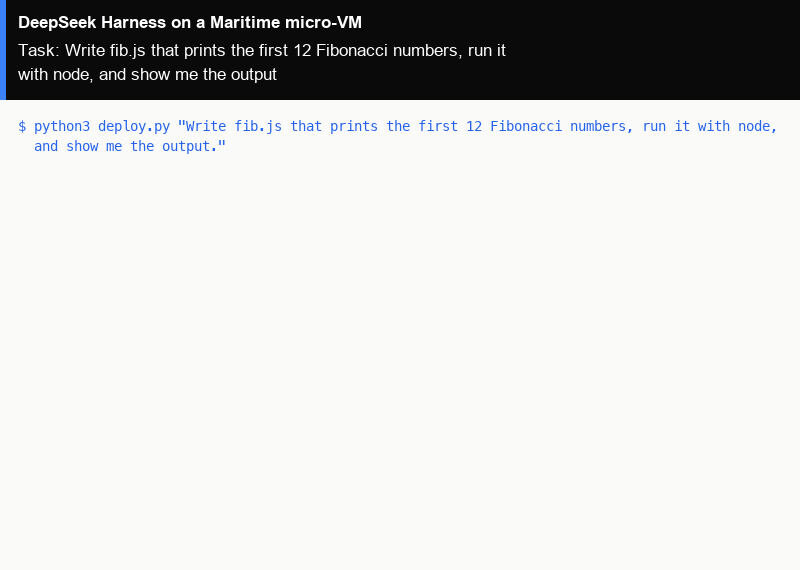

# DeepSeek Harness as a hosted agent on Maritime

[DeepSeek Harness](https://github.com/deepseek-ai/deepseek-harness) (dsh) is DeepSeek's open-source agent harness, where models, tools, skills, sessions and the web workbench are all plugins, and every run is recorded in a session log you can resume and replay. Here it runs as a Maritime hosted agent: its own micro-VM with a persistent workspace, which sleeps when idle and wakes on the next message. One command creates it and gives it a task.

<p align="center"></p>

[](https://maritime.sh/agents/new?template=dsh)

## Run it

```bash
git clone https://github.com/maritime-sh/agents && cd agents/deepseek-harness
export MARITIME_API_KEY=mk_...            # maritime.sh, Settings, API keys
python3 deploy.py "Write fib.js that prints the first 12 Fibonacci numbers, run it with node, and show me the output."
```

The first run creates the agent `lib-deepseek-harness` from Maritime's `dsh` template, waits until it is active (about a minute), sends your task through chat and prints the reply. Run it again with a new task and it talks to the same agent, waking it if it is asleep. `--name` picks another agent name.

No model key is needed: the agent uses Maritime LLM, paid from your account's AI credits. To pay your provider directly instead, add `OPENAI_API_KEY` as a secret environment variable in the agent's Settings on maritime.sh and restart it. Other providers, DeepSeek's API among them, can be added in the workbench under Settings, Models.

| | |
|---|---|
| Computer | A hosted agent: its own Firecracker micro-VM that sleeps when idle and wakes on the next message |
| Upstream | `@deepseek-ai/dsh@0.1.0-rc.7` from npm, unchanged, inside Maritime's `dsh` template image `ghcr.io/maritime-sh/dsh-agent:0.1.0-rc.7`. Upstream is a developer preview, so the version is pinned |
| Model | Maritime LLM by default (`DSH_MODEL`, default `gpt-5-mini`), or your own OpenAI key set on the agent |
| Where it runs | Inside the agent's micro-VM. The workspace is `/data/workspace` and dsh's state and session logs are in `/data/.dsh`, both kept across sleep and restarts |
| Needs | Python 3.9+ on your machine (standard library only) |

## How it works

- `deploy.py` (Python 3, standard library only) calls the Maritime REST API: `POST /api/agents` with `templateId: "dsh"`, then `GET /api/agents/{id}` until the status is `active`.
- Your task goes to `POST /api/agents/{id}/chat`. A turn that runs longer than the request comes back as a receipt, and the script polls it until the reply is ready.
- The template image adds a small auth layer in front of dsh's web workbench, which upstream ships without authentication, and a config file pointing dsh at Maritime LLM. dsh itself is the npm release, unchanged.
- Chat messages run as one-shot headless dsh turns with tools on; recent context carries over between messages.
- For the full workbench (sessions, plan mode, tool approvals, replay), open the agent on maritime.sh and click **Harness Workbench**. More in the [DeepSeek Harness guide](https://maritime.sh/docs/frameworks/deepseek-harness).
- `../common/terminal_frames.py` turned the real output of a run into the demo GIF, with `common/make_gif.py`.

## Tested

End to end on a real Maritime account, from a fresh agent: see [TESTING.md](../TESTING.md).

## License and credits

DeepSeek Harness is MIT licensed (Copyright (c) 2026 DeepSeek). This folder is MIT licensed.

This is a community integration, not affiliated with or endorsed by DeepSeek.
