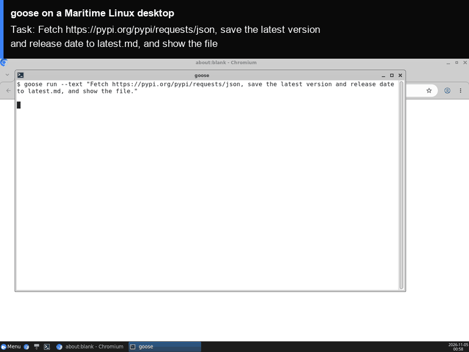

# goose on a Maritime Linux desktop

[goose](https://github.com/aaif-goose/goose) is an open-source AI agent that works from your terminal: you give it a task, and it writes and runs shell commands and code until the task is done. Here the goose CLI runs on its own Maritime Linux desktop, in a terminal on the computer's screen that you can watch live. Its files and settings stay on the computer between runs.

<p align="center"></p>

[](https://maritime.sh/dashboard/new-sandbox?type=computers&agent=goose)

## Run it

```bash
git clone https://github.com/maritime-sh/agents && cd agents/goose
export MARITIME_API_KEY=mk_...            # maritime.sh, Settings, API keys
export OPENAI_API_KEY=sk-...              # any OpenAI-compatible endpoint
export OPENAI_BASE_URL=https://...        # optional, for an endpoint other than OpenAI
python3 deploy.py "Fetch https://pypi.org/pypi/requests/json, save the latest version and release date to latest.md, and show the file."
```

The script prints a link to watch the desktop, downloads goose the first time (a few seconds), opens a terminal on the desktop, runs the task, and streams goose's output and final answer. Run it again with a new task and it reuses the same computer.

| | |
|---|---|
| Computer | Linux desktop (Debian, XFCE, Chromium), $0.12 an hour while awake |
| Upstream | goose CLI `v1.57.0`, the official release binary (`goose-x86_64-unknown-linux-gnu.tar.gz`, SHA-256 checked), unchanged |
| Model | Any OpenAI-compatible endpoint (`OPENAI_BASE_URL`). `GOOSE_MODEL` picks the model (default `gpt-5.4`); set `GOOSE_PROVIDER` to use another goose provider |
| Where it runs | Inside the computer, under `/data/agents/goose`. goose works in `/data/agents/goose/work` |
| Needs | Python 3.9+ on your machine (standard library only) |

## How it works

- `deploy.py` creates (or reuses) the computer through the Maritime REST API and uploads `agent/`.
- `agent/install.sh` downloads the pinned goose release into `/data`, which survives sleep and restarts, and checks its SHA-256.
- `agent/run.sh` sets goose's OpenAI provider from your endpoint, opens a terminal on the desktop, and runs `goose run --with-builtin developer` with your task. The terminal view leaves out the ASCII art in goose's start banner.
- goose runs in auto mode, so it runs commands without asking. It only has this computer to act on.
- Your model key is written to `/data/agents/goose/.env` with mode 600, on your own computer only.

## Tested

End to end on a real Maritime Linux desktop, from a clean computer: see [TESTING.md](../TESTING.md).

## License and credits

goose is Apache-2.0 licensed (Copyright 2024 Block, Inc.). This folder is MIT licensed.

This is a community integration, not affiliated with or endorsed by goose.
