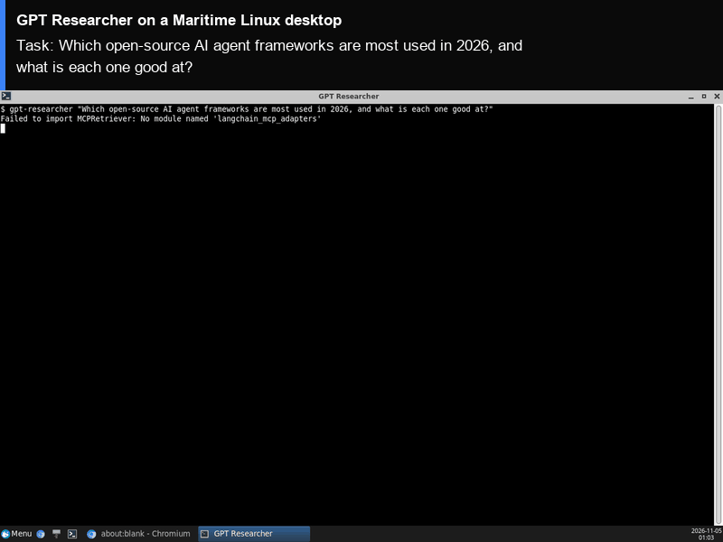

# GPT Researcher on a Maritime Linux desktop

[GPT Researcher](https://github.com/assafelovic/gpt-researcher) is an open-source research agent: give it a question and it plans sub-questions, searches the web, reads the pages it finds, and writes a cited report. Here it runs on its own Maritime Linux desktop, in a terminal you can watch live, and the finished report opens in a text editor on the same screen. Reports stay on the computer between runs.

<p align="center"></p>

[](https://maritime.sh/dashboard/new-sandbox?type=computers&agent=gpt-researcher)

## Run it

```bash
git clone https://github.com/maritime-sh/agents && cd agents/gpt-researcher
export MARITIME_API_KEY=mk_...            # maritime.sh, Settings, API keys
export OPENAI_API_KEY=...                 # plus OPENAI_BASE_URL for any OpenAI-compatible endpoint
python3 deploy.py "Which open-source AI agent frameworks are most used in 2026, and what is each one good at?"
```

The script prints a link to watch the desktop, installs GPT Researcher the first time (under a minute), runs the research in a terminal on the desktop, opens the report in Mousepad when it is done, and streams the same output to you. A run takes two to three minutes. Run it again with a new question and it reuses the same computer.

| | |
|---|---|
| Computer | Linux desktop (Debian, XFCE), $0.12 an hour while awake |
| Upstream | `gpt-researcher==0.16.1` from PyPI, unchanged, with `ddgs==9.16.1` for DuckDuckGo search. Other dependencies are held to the versions it was tested with (`agent/constraints.txt`) |
| Model | Any OpenAI-compatible endpoint that also serves embeddings. Defaults: `openai:gpt-5.4` (smart and strategic), `openai:gpt-5-mini` (fast), `openai:text-embedding-3-small`. GPT Researcher's own variables (`SMART_LLM`, `FAST_LLM`, `STRATEGIC_LLM`, `EMBEDDING`, `TOTAL_WORDS`) override them |
| Search | DuckDuckGo, no key needed. Set `RETRIEVER=tavily` and `TAVILY_API_KEY` to use Tavily, GPT Researcher's default |
| Where it runs | Inside the computer, under `/data/agents/gpt-researcher`. Reports are saved in `/data/agents/gpt-researcher/reports` |
| Needs | Python 3.9+ on your machine (standard library only) |

## How it works

- `deploy.py` creates (or reuses) the computer through the Maritime REST API and uploads `agent/`.
- `agent/install.sh` installs `uv` and the pinned GPT Researcher release into `/data`, which survives sleep and restarts.
- `agent/show.sh` opens a terminal on the desktop and runs `agent/run.py`, which calls GPT Researcher's `conduct_research()` and `write_report()` and saves the Markdown report. Then it opens the report in Mousepad.
- Your keys are written to `/data/agents/gpt-researcher/.env` with mode 600, on your own computer only.

## Tested

End to end on a real Maritime Linux desktop, from a clean computer: see [TESTING.md](../TESTING.md).

## License and credits

GPT Researcher is Apache-2.0 licensed (the repository's LICENSE file; its PyPI metadata says MIT). The LICENSE file carries no copyright line; the project and package are by Assaf Elovic and contributors. This folder is MIT licensed.

This is a community integration, not affiliated with or endorsed by GPT Researcher.
