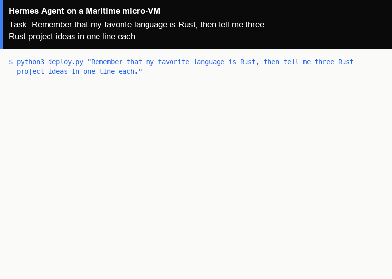

# Hermes Agent as a hosted agent on Maritime

[Hermes Agent](https://github.com/NousResearch/hermes-agent) is Nous Research's open-source Python agent with persistent memory: it writes what it learns about you and its tasks to files and uses them in later conversations. Here it runs as a Maritime hosted agent: the official Hermes image on its own micro-VM that sleeps when idle and wakes on the next message, with its memory kept on the agent's disk. One command creates it and gives it a task.

<p align="center"></p>

[](https://maritime.sh/agents/new?template=hermes)

## Run it

```bash
git clone https://github.com/maritime-sh/agents && cd agents/hermes-agent
export MARITIME_API_KEY=mk_...            # maritime.sh, Settings, API keys
python3 deploy.py "Remember that my favorite language is Rust, then tell me three Rust project ideas in one line each."
```

The first run creates the agent `lib-hermes-agent` from Maritime's `hermes` template, waits until it is active (about a minute), sends your task through chat and prints the reply. Run it again with a new task and it talks to the same agent, waking it if it is asleep. `--name` picks another agent name.

No model key is needed: the agent uses Maritime LLM, paid from your account's AI credits. To pay your provider directly instead, add `OPENAI_API_KEY` as a secret environment variable in the agent's Settings on maritime.sh and restart it.

| | |
|---|---|
| Computer | A hosted agent: its own Firecracker micro-VM that sleeps when idle and wakes on the next message |
| Upstream | The official image `nousresearch/hermes-agent:v2026.5.16` (Hermes Agent v0.14.0), unchanged. This is the tag Maritime's `hermes` template pins |
| Model | Maritime LLM by default (`gpt-5.4` through Hermes's `openai` provider), or your own OpenAI key set on the agent |
| Where it runs | Inside the agent's micro-VM, with `HERMES_HOME=/opt/data`. Memory lives in `/opt/data/memories` and survives sleep and restarts |
| Needs | Python 3.9+ on your machine (standard library only) |

## How it works

- `deploy.py` (Python 3, standard library only) calls the Maritime REST API: `POST /api/agents` with `templateId: "hermes"`, then `GET /api/agents/{id}` until the status is `active`.
- Your task goes to `POST /api/agents/{id}/chat`. A turn that runs longer than the request comes back as a receipt, and the script polls it until the reply is ready.
- Hermes has no HTTP chat endpoint of its own, so Maritime runs `hermes chat -q` inside the micro-VM for each message. Nothing in Hermes is changed.
- Memory carries across runs: tell it something with one `deploy.py` run and ask about it in the next.
- For Hermes's own dashboard (sessions, files, skills, logs), open the agent on maritime.sh and click **Hermes Dashboard**. More in the [Hermes guide](https://maritime.sh/docs/frameworks/hermes).
- `../common/terminal_frames.py` turned the real output of a run into the demo GIF, with `common/make_gif.py`.

## Tested

End to end on a real Maritime account, from a fresh agent: see [TESTING.md](../TESTING.md).

## License and credits

Hermes Agent is MIT licensed (Copyright (c) 2025 Nous Research). This folder is MIT licensed.

This is a community integration, not affiliated with or endorsed by Nous Research.
