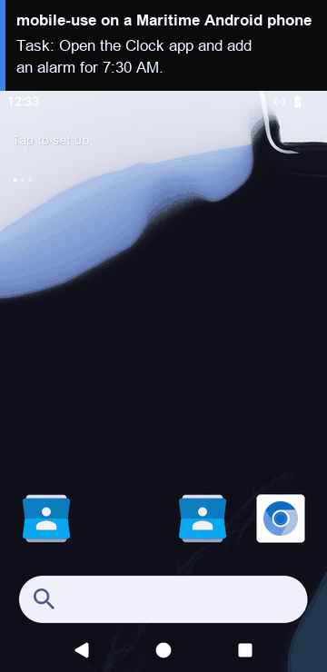

# mobile-use on a Maritime Android phone

[mobile-use](https://github.com/minitap-ai/mobile-use) is an open-source agent that uses an Android phone from a plain-English goal: a team of small agents (planner, orchestrator, cortex, executor) reads the screen and its UI tree, then taps, swipes and types until the goal is done. Here the phone is an Android 15 phone in the cloud on Maritime, in its own VM, so you need no device and no emulator on your machine.

<p align="center"></p>

[](https://maritime.sh/dashboard/new-sandbox?type=android&agent=mobile-use)

## Run it

```bash
git clone https://github.com/maritime-sh/agents && cd agents/mobile-use
export MARITIME_API_KEY=mk_...            # maritime.sh, Settings, API keys
export OPENAI_API_KEY=...                 # plus OPENAI_BASE_URL for any OpenAI-compatible endpoint
python3 deploy.py "Open the Clock app and add an alarm for 7:30 AM."
```

The script prints a link to watch the phone, opens Maritime's adb tunnel, installs mobile-use on your machine the first time (about a minute), runs the task, and prints the agent's final answer. Run it again with a new task and it reuses the same phone.

| | |
|---|---|
| Computer | Android phone: AOSP Android 15, 720x1280, no Google Play, $0.15 an hour while awake |
| Upstream | `minitap-mobile-use==4.0.0` from PyPI, unchanged. Its dependencies are held to the versions upstream locked for that release (`agent/constraints.txt`, from its `uv.lock`) |
| Model | Any OpenAI-compatible endpoint (`OPENAI_API_KEY`, `OPENAI_BASE_URL`). `MOBILE_USE_MODEL` (default `gpt-5.4`) plans and decides, `MOBILE_USE_FAST_MODEL` (default `gpt-5-mini`) runs the small steps |
| Where it runs | mobile-use runs on your machine and reaches the phone through Maritime's adb tunnel. Its venv is `~/.cache/maritime-agents/mobile-use-4.0.0` |
| Needs | Python 3 on your machine, [uv](https://docs.astral.sh/uv/) and `adb` (Android platform-tools) |

## How it works

- `deploy.py` creates (or reuses) the phone and opens Maritime's adb tunnel (`WS /api/v1/computers/{id}/adb`) on a local port with `../common/adb_tunnel.py`. `adb` sees the phone as a network device.
- `agent/run.py` builds mobile-use's LLM config for one OpenAI-compatible endpoint and runs the task through mobile-use's own SDK (`Agent`, `AgentProfile`, `for_device`). It reads the screen with UIAutomator2, which mobile-use sets up on the phone on the first run.
- Anonymous usage telemetry is switched off (`MOBILE_USE_TELEMETRY_ENABLED=false`).
- The phone keeps its disk while it sleeps, so apps and settings from earlier runs are still there.

## Tested

End to end on a real Maritime Android phone: see [TESTING.md](../TESTING.md).

## License and credits

mobile-use is Apache-2.0 licensed (Copyright 2025-2026 Minitap, Inc.), developed by Minitap, Inc. This folder is MIT licensed.

This is a community integration, not affiliated with or endorsed by Minitap or mobile-use.
