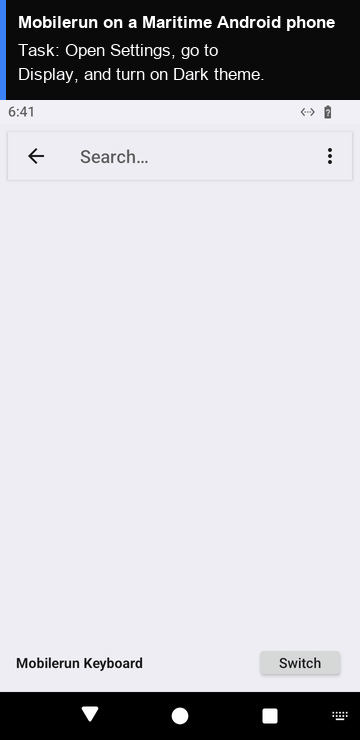

# Mobilerun (formerly DroidRun) on a Maritime Android phone

[Mobilerun](https://github.com/droidrun/mobilerun), the open-source framework formerly called DroidRun, lets an LLM agent use an Android phone: it reads the screen's UI tree, taps, swipes and types until the task is done. Here the phone is an Android 15 phone in the cloud on Maritime, in its own VM, so you need no device and no emulator on your machine.

<p align="center"></p>

[](https://maritime.sh/dashboard/new-sandbox?type=android&agent=mobilerun)

## Run it

```bash
git clone https://github.com/maritime-sh/agents && cd agents/mobilerun
export MARITIME_API_KEY=mk_...
export GOOGLE_API_KEY=...          # or OPENAI_API_KEY, or ANTHROPIC_API_KEY
python3 deploy.py "Open the Settings app and tell me which Android version this phone runs"
```

| | |
|---|---|
| Computer | Android phone: AOSP Android 15, 720x1280, no Google Play, $0.15 an hour while awake |
| Upstream | `mobilerun[anthropic]==0.7.4` from PyPI and its Portal app `0.7.28`, unchanged |
| Model | Gemini, any OpenAI-compatible endpoint (`OPENAI_BASE_URL`), or Claude. `MOBILERUN_MODEL` picks the model. `--vision` also sends screenshots |
| Where it runs | Mobilerun runs on your machine and reaches the phone through Maritime's adb tunnel |
| Needs | [uv](https://docs.astral.sh/uv/) and `adb` (Android platform-tools) on your machine |

## How it works

- `deploy.py` creates (or reuses) the phone and opens Maritime's adb tunnel (`WS /api/v1/computers/{id}/adb`) on a local port with `../common/adb_tunnel.py`. `adb` sees the phone as a network device.
- The first run installs the Mobilerun Portal on the phone (`mobilerun setup`). It stays installed: the phone keeps its disk while it sleeps.
- Each run calls `mobilerun run` with your task. Watch the phone from the link the script prints.

Apps install as APKs (`adb install app.apk`). The default phone is x86_64; apps that ship only ARM code need an ARM phone where your account has one.

## Tested

End to end on a real Maritime Android phone: see [TESTING.md](../TESTING.md).

## License and credits

Mobilerun is MIT licensed (Copyright (c) 2025 Niels Schmidt). This folder is MIT licensed.

This is a community integration, not affiliated with or endorsed by Mobilerun or DroidRun.
