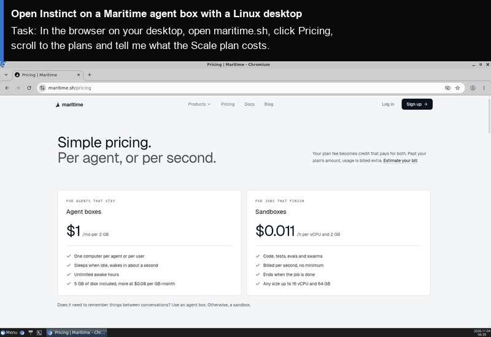

# Open Instinct on Maritime

[Open Instinct](https://github.com/mariagorskikh/open-instinct) is an open-source personal agent you text. It has its own computer, does real tasks (browses, books, fills forms, writes files), and coordinates with the agents of people you trust, with a permission tier for each of them. On Maritime each person's agent gets its own micro-VM with a Linux desktop that sleeps when nobody is talking to it and wakes when a message arrives.

<p align="center"></p>

[](https://maritime.sh/dashboard/new-sandbox?type=persistent&agent=open-instinct)

## Run it

```bash
git clone https://github.com/maritime-sh/agents && cd agents/open-instinct
export MARITIME_API_KEY=mk_...
export ANTHROPIC_API_KEY=sk-ant-...
./deploy.sh --name "Ada" --handle ada-instinct
```

No model key of your own? Add `--maritime-llm` and the agent uses Maritime's metered model endpoint.

| | |
|---|---|
| Computer | An agent box with a Linux desktop: its own micro-VM that keeps `/data`, sleeps when idle and wakes on the next message |
| Upstream | `mariagorskikh/open-instinct` at commit `2e5e71b` and its published image `ghcr.io/mariagorskikh/open-instinct-agent:sha-2e5e71b`, unchanged |
| Model | Claude by default (`ANTHROPIC_API_KEY`), or `--maritime-llm` |
| Optional | `INKBOX_ADMIN_API_KEY` for an iMessage line, `COMPOSIO_API_KEY` for Gmail and Calendar, Stripe Link for payments. See the upstream [KEYS.md](https://github.com/mariagorskikh/open-instinct/blob/main/docs/KEYS.md) |
| Needs | Node 22.19+, pnpm 10, git |

## How it works

`deploy.sh` clones and builds the pinned commit, then runs Open Instinct's own CLI: `instinct init` writes the agent's config, `instinct deploy` creates the Maritime agent from the published image with a desktop, and `instinct chat` says hello. Everything after that (iMessage, the gateway for many users, payments) is in the upstream [Deploy on Maritime](https://github.com/mariagorskikh/open-instinct/blob/main/docs/DEPLOY-MARITIME.md) guide.

## Tested

End to end on a real Maritime account: see [TESTING.md](../TESTING.md).

## License and credits

Open Instinct is MIT licensed and is made by Maria Gorskikh, a co-founder of Maritime. It is not affiliated with Instinct or with the OpenInstinct project by Merit Systems.
