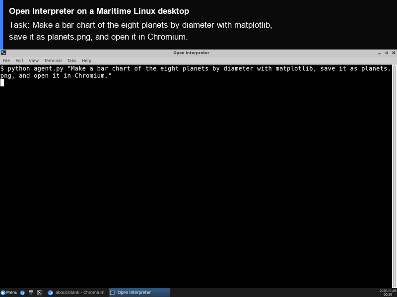

# Open Interpreter on a Maritime Linux desktop

[Open Interpreter](https://github.com/openinterpreter/openinterpreter) lets a language model run code on a computer: you ask in plain English, it writes Python or shell commands, runs them, reads the output and keeps going until the task is done. Here it runs on its own Maritime Linux desktop, so the code runs on that computer and not on yours, and the windows it opens (a chart, a browser) show up on a screen you can watch live.

<p align="center"></p>

[](https://maritime.sh/dashboard/new-sandbox?type=computers&agent=open-interpreter)

## Run it

```bash
git clone https://github.com/maritime-sh/agents && cd agents/open-interpreter
export MARITIME_API_KEY=mk_...                     # maritime.sh, Settings, API keys
export OPENAI_API_KEY=sk-...                       # any OpenAI-compatible endpoint
export OPENAI_BASE_URL=https://api.openai.com/v1   # optional, for another endpoint
python3 deploy.py "Make a bar chart of the eight planets by diameter with matplotlib, save it as planets.png, and open it in Chromium."
```

The script prints a link to watch the desktop, installs Open Interpreter the first time, opens a terminal on the desktop, runs the task, and streams the session to your terminal. Run it again with a new task and it reuses the same computer, already set up.

Open Interpreter runs the code it writes without asking first (`auto_run`), because the computer is its own and holds nothing else. Keep that in mind before you put logins or files on it.

| | |
|---|---|
| Computer | Linux desktop (Debian, XFCE, Chromium), $0.12 an hour while awake |
| Upstream | `open-interpreter==0.4.3` from PyPI, unchanged. This is the last release of the Python project; the upstream repository has since moved to a separate Rust rewrite |
| Model | Any OpenAI-compatible endpoint (`OPENAI_API_KEY`, optional `OPENAI_BASE_URL`). `INTERPRETER_MODEL` picks the model, default `gpt-5.4` |
| Where it runs | Inside the computer, under `/data/agents/open-interpreter`. Its working folder is `/data/agents/open-interpreter/work` |
| Needs | Python 3.9+ on your machine (standard library only) |

## How it works

- `deploy.py` creates (or reuses) the computer through the Maritime REST API and uploads `agent/`.
- `agent/install.sh` installs `uv`, Python 3.12 and the pinned Open Interpreter release into `/data`, which survives sleep and restarts. It adds `setuptools==80.9.0` (0.4.3 imports `pkg_resources`, which newer setuptools no longer ships), plus `pip` and `matplotlib` so the code it writes can install packages and plot.
- `agent/agent.py` points Open Interpreter at your model, turns on `auto_run`, tells it it is on a Linux desktop with Chromium, and runs your task.
- `agent/run.sh` opens a terminal window on the desktop and runs it there (`agent/session.sh`), so you can watch the code and its output.
- Your model key is written to `/data/agents/open-interpreter/.env` with mode 600, on your own computer only.

## Tested

End to end on a real Maritime Linux desktop, from a clean computer: see [TESTING.md](../TESTING.md).

## License and credits

Open Interpreter 0.4.3 is licensed under the GNU Affero General Public License v3.0, the `LICENSE` shipped in its wheel. That file carries no project copyright line; the package lists Killian Lucas as author. The current upstream repository, a Rust rewrite, is Apache-2.0. This folder installs the release unchanged and does not include its code; this folder is MIT licensed.

This is a community integration, not affiliated with or endorsed by Open Interpreter.
