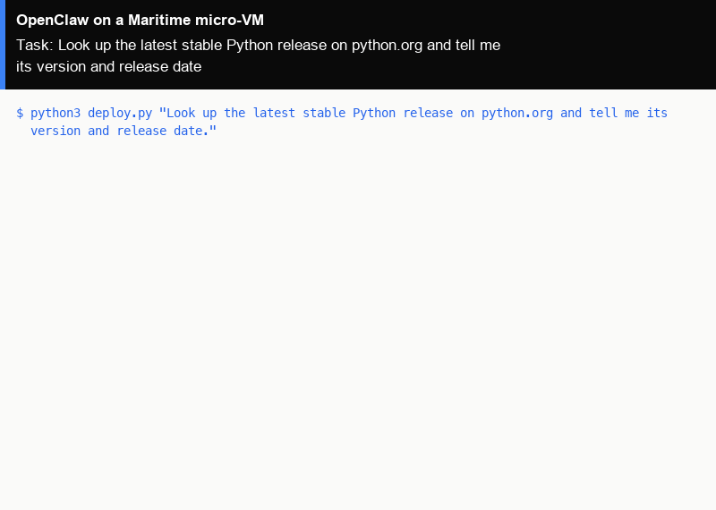

# OpenClaw as a hosted agent on Maritime

[OpenClaw](https://github.com/openclaw/openclaw) is an open-source, general-purpose assistant written in Node.js, with a large set of built-in skills: web browsing, running code, managing files, and channels such as Telegram and WhatsApp. Here it runs as a Maritime hosted agent: the official OpenClaw image on its own micro-VM that sleeps when nobody is talking to it and wakes on the next message. One command creates it and gives it a task.

<p align="center"></p>

[](https://maritime.sh/agents/new?template=openclaw)

## Run it

```bash
git clone https://github.com/maritime-sh/agents && cd agents/openclaw
export MARITIME_API_KEY=mk_...            # maritime.sh, Settings, API keys
python3 deploy.py "Look up the latest stable Python release on python.org and tell me its version and release date."
```

The first run creates the agent `lib-openclaw` from Maritime's `openclaw` template, waits until it is active (about a minute), sends your task through chat and prints the reply. Run it again with a new task and it talks to the same agent, waking it if it is asleep. `--name` picks another agent name.

No model key is needed: the agent uses Maritime LLM, paid from your account's AI credits. To pay your provider directly instead, add `OPENAI_API_KEY` or `ANTHROPIC_API_KEY` as a secret environment variable in the agent's Settings on maritime.sh and restart it.

| | |
|---|---|
| Computer | A hosted agent: its own Firecracker micro-VM that sleeps when idle and wakes on the next message |
| Upstream | The official image `ghcr.io/openclaw/openclaw:2026.7.1` (OpenClaw `2026.7.1`), unchanged. This is the tag Maritime's `openclaw` template pins |
| Model | Maritime LLM by default, or your own OpenAI or Anthropic key set on the agent |
| Where it runs | Inside the agent's micro-VM. OpenClaw's gateway listens on port 18789; its config and sessions stay on the agent's disk |
| Needs | Python 3.9+ on your machine (standard library only) |

## How it works

- `deploy.py` (Python 3, standard library only) calls the Maritime REST API: `POST /api/agents` with `templateId: "openclaw"`, then `GET /api/agents/{id}` until the status is `active`.
- Your task goes to `POST /api/agents/{id}/chat`. A turn that runs longer than the request comes back as a receipt, and the script polls it until the reply is ready.
- Maritime starts the image with `OPENCLAW_HEADLESS=true` and routes chat into OpenClaw's own CLI inside the micro-VM. Nothing in OpenClaw is changed.
- For OpenClaw's own web UI, open the agent on maritime.sh and click **OpenClaw Dashboard**. More in the [OpenClaw guide](https://maritime.sh/docs/frameworks/openclaw).
- `../common/terminal_frames.py` turned the real output of a run into the demo GIF, with `common/make_gif.py`.

## Tested

End to end on a real Maritime account, from a fresh agent: see [TESTING.md](../TESTING.md).

## License and credits

OpenClaw is MIT licensed (Copyright (c) 2026 OpenClaw Foundation). This folder is MIT licensed.

This is a community integration, not affiliated with or endorsed by OpenClaw.
