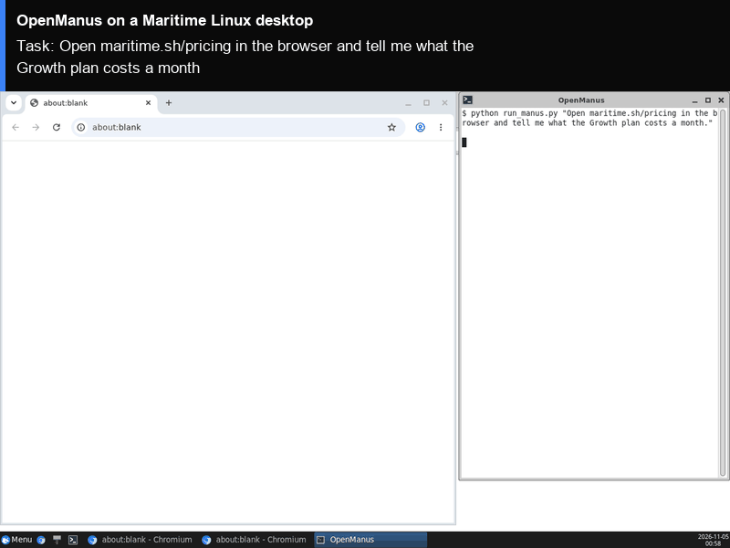

# OpenManus on a Maritime Linux desktop

[OpenManus](https://github.com/FoundationAgents/OpenManus) is an open-source general agent: it plans a task, then uses a browser, Python and file tools step by step until it is done. Here it runs on its own Maritime Linux desktop, driving a real Chromium window on the computer's screen, with its steps in a terminal beside it. You can watch both live and take over the browser at any moment. Its browser profile, so its logins, stay on the computer between runs.

<p align="center"></p>

[](https://maritime.sh/dashboard/new-sandbox?type=computers&agent=openmanus)

## Run it

```bash
git clone https://github.com/maritime-sh/agents && cd agents/openmanus
export MARITIME_API_KEY=mk_...            # maritime.sh, Settings, API keys
export OPENAI_API_KEY=sk-...              # any OpenAI-compatible endpoint
export OPENAI_BASE_URL=https://...        # optional, for an endpoint other than OpenAI
python3 deploy.py "Open maritime.sh/pricing in the browser and tell me what the Growth plan costs a month."
```

The script prints a link to watch the desktop, installs OpenManus the first time (about ten minutes, it has many dependencies), runs the task, and streams the agent's steps and final answer. Run it again with a new task and it reuses the same computer, already set up.

| | |
|---|---|
| Computer | Linux desktop (Debian, XFCE, Chromium), $0.12 an hour while awake |
| Upstream | OpenManus commit `3309bf4` (source archive from GitHub, its `requirements.txt`), unchanged. Its browser tool is `browser-use==0.13.14` from PyPI |
| Model | Any OpenAI-compatible endpoint (`OPENAI_BASE_URL`). `OPENMANUS_MODEL` picks the model (default `gpt-5.4`) |
| Where it runs | Inside the computer, under `/data/agents/openmanus`. The browser profile is `/data/agents/openmanus/profile` |
| Needs | Python 3.9+ on your machine (standard library only) |

## How it works

- `deploy.py` creates (or reuses) the computer through the Maritime REST API and uploads `agent/`.
- `agent/install.sh` downloads the pinned OpenManus source, installs Python 3.12 and its requirements with `uv` into `/data` (CPU builds of PyTorch, since a benchmark dependency pulls it in), and installs the pinned browser-use in its own environment.
- `agent/run.sh` starts the desktop's Chromium with remote debugging on, visible on the screen, and opens a terminal next to it that shows the agent's steps.
- `agent/run_manus.py` writes OpenManus's own `config/config.toml` (your model) and `config/mcp.json` (the pinned browser tool, attached to that Chromium), then runs the upstream `Manus` agent with your task.
- OpenManus sends the newer `max_completion_tokens` parameter, and passes screenshots, only to models on two lists in its code. `run_manus.py` adds your model to those lists when it starts; no upstream file is changed.
- Your model key is written to `/data/agents/openmanus/.env` and to OpenManus's config file, both mode 600, on your own computer only.

## Tested

End to end on a real Maritime Linux desktop, from a clean computer: see [TESTING.md](../TESTING.md).

## License and credits

OpenManus is MIT licensed (Copyright (c) 2025 manna_and_poem). browser-use is MIT licensed (Copyright (c) 2024 Gregor Zunic). This folder is MIT licensed.

This is a community integration, not affiliated with or endorsed by OpenManus.
