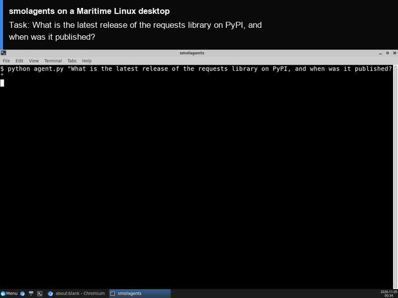

# smolagents on a Maritime Linux desktop

[smolagents](https://github.com/huggingface/smolagents) is a small library for agents that think in code: a `CodeAgent` writes a few lines of Python at each step, calls its tools from that code, and reads the output before the next step. Here a `CodeAgent` with web search and a webpage reader runs on its own Maritime Linux desktop, in a terminal window you can watch live, so the code it writes runs on that computer and not on yours.

<p align="center"></p>

[](https://maritime.sh/dashboard/new-sandbox?type=computers&agent=smolagents)

## Run it

```bash
git clone https://github.com/maritime-sh/agents && cd agents/smolagents
export MARITIME_API_KEY=mk_...                     # maritime.sh, Settings, API keys
export OPENAI_API_KEY=sk-...                       # any OpenAI-compatible endpoint
export OPENAI_BASE_URL=https://api.openai.com/v1   # optional, for another endpoint
python3 deploy.py "What is the latest release of the requests library on PyPI, and when was it published?"
```

The script prints a link to watch the desktop, installs smolagents the first time, opens a terminal on the desktop, runs the task, and streams each step and the final answer to your terminal. Run it again with a new task and it reuses the same computer, already set up.

| | |
|---|---|
| Computer | Linux desktop (Debian, XFCE), $0.12 an hour while awake |
| Upstream | `smolagents[toolkit,openai]==1.26.0` from PyPI, unchanged |
| Model | Any OpenAI-compatible endpoint through `OpenAIServerModel` (`OPENAI_API_KEY`, optional `OPENAI_BASE_URL`). `SMOLAGENTS_MODEL` picks the model, default `gpt-5.4`; `SMOLAGENTS_MAX_STEPS` caps the steps, default 8 |
| Where it runs | Inside the computer, under `/data/agents/smolagents` |
| Needs | Python 3.9+ on your machine (standard library only) |

## How it works

- `deploy.py` creates (or reuses) the computer through the Maritime REST API and uploads `agent/`.
- `agent/install.sh` installs `uv` and the pinned smolagents release into `/data`, which survives sleep and restarts.
- `agent/agent.py` builds a `CodeAgent` with smolagents' own `WebSearchTool` and `VisitWebpageTool` and runs your task.
- `agent/run.sh` opens a terminal window on the desktop and runs it there (`agent/session.sh`), so you can watch each step.
- Your model key is written to `/data/agents/smolagents/.env` with mode 600, on your own computer only.

## Tested

End to end on a real Maritime Linux desktop, from a clean computer: see [TESTING.md](../TESTING.md).

## License and credits

smolagents is licensed under the Apache License 2.0 (Copyright 2024 The HuggingFace Inc. team. All rights reserved., from its source file headers; the `LICENSE` file itself has no copyright line). This folder is MIT licensed.

This is a community integration, not affiliated with or endorsed by smolagents or Hugging Face.
