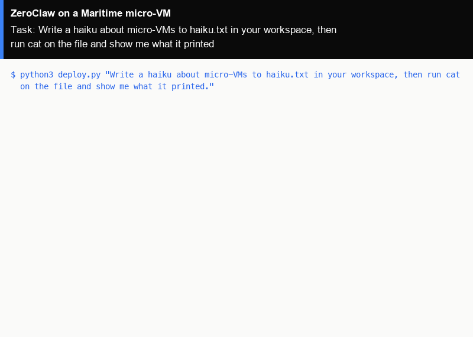

# ZeroClaw as a hosted agent on Maritime

[ZeroClaw](https://github.com/zeroclaw-labs/zeroclaw) is an open-source agent shipped as a single Rust binary, with a gateway and an OpenAI-compatible chat API. It uses very little memory and starts in under a second, which suits running many agents. Here it runs as a Maritime hosted agent: the official ZeroClaw image on its own micro-VM that sleeps when idle and wakes on the next message. One command creates it and gives it a task.

<p align="center"></p>

[](https://maritime.sh/agents/new?template=zeroclaw)

## Run it

```bash
git clone https://github.com/maritime-sh/agents && cd agents/zeroclaw
export MARITIME_API_KEY=mk_...            # maritime.sh, Settings, API keys
python3 deploy.py "Write a haiku about micro-VMs to haiku.txt in your workspace, then run cat on the file and show me what it printed."
```

The first run creates the agent `lib-zeroclaw` from Maritime's `zeroclaw` template, waits until it is active (about two minutes), sends your task through chat and prints the reply. Run it again with a new task and it talks to the same agent, waking it if it is asleep. `--name` picks another agent name.

No model key is needed: the agent uses Maritime LLM, paid from your account's AI credits. To pay your provider directly instead, add `OPENAI_API_KEY` or `ANTHROPIC_API_KEY` as a secret environment variable in the agent's Settings on maritime.sh and restart it.

| | |
|---|---|
| Computer | A hosted agent: its own Firecracker micro-VM that sleeps when idle and wakes on the next message |
| Upstream | The official image `ghcr.io/zeroclaw-labs/zeroclaw:v0.8.5-debian` (ZeroClaw `0.8.5`), unchanged. This is the tag Maritime's `zeroclaw` template pins |
| Model | Maritime LLM by default (an OpenAI-compatible provider), or your own OpenAI or Anthropic key set on the agent |
| Where it runs | Inside the agent's micro-VM, with HOME at `/zeroclaw-data`. Files the agent writes stay on the agent's disk |
| Needs | Python 3.9+ on your machine (standard library only) |

## How it works

- `deploy.py` (Python 3, standard library only) calls the Maritime REST API: `POST /api/agents` with `templateId: "zeroclaw"`, then `GET /api/agents/{id}` until the status is `active`.
- Your task goes to `POST /api/agents/{id}/chat`. A turn that runs longer than the request comes back as a receipt, and the script polls it until the reply is ready.
- Maritime configures ZeroClaw only through its own `ZEROCLAW_*` environment variables: gateway on port 42617, device pairing off so the Maritime proxy can connect, and full autonomy because the micro-VM is the sandbox. Set any `ZEROCLAW_*` variable on the agent to override one setting.
- For ZeroClaw's own web UI, open the agent on maritime.sh and click **ZeroClaw Dashboard**. More in the [ZeroClaw guide](https://maritime.sh/docs/frameworks/zeroclaw).
- `../common/terminal_frames.py` turned the real output of a run into the demo GIF, with `common/make_gif.py`.

## Tested

End to end on a real Maritime account, from a fresh agent: see [TESTING.md](../TESTING.md).

## License and credits

ZeroClaw is dual licensed under MIT and Apache 2.0 (Copyright (c) 2025 ZeroClaw Labs). This folder is MIT licensed.

This is a community integration, not affiliated with or endorsed by ZeroClaw Labs.
